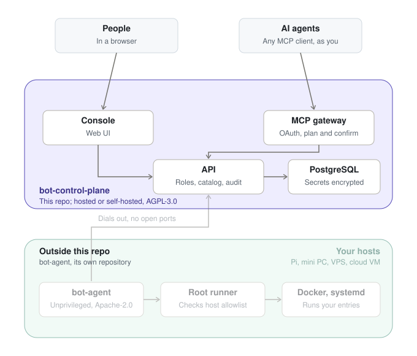

# bot-control-plane

The server side of [Deploybot](https://deploybot.dev): the API, the MCP gateway for AI agents, and the web console. Hosts run the separate agent, [bot-agent](https://github.com/more-than-code/bot-agent), which dials out to the API. The product overview lives in [more-than-code/deploybot](https://github.com/more-than-code/deploybot).



## Layout

| Path | What it is |
|------|------------|
| `api/` | The API: Google sign-in and sessions, organizations and projects with their members, join tokens, host credentials and host access, the agent WebSocket, metrics ingest into Postgres, the catalog, audit, and the OAuth server for MCP clients. The only part that writes the database or decides permissions. [README](api/README.md), [design](api/docs/design.md). |
| `mcp/` | The stateless MCP gateway (Streamable HTTP at `/mcp`), acting as the signed-in user, and the `deploybot login` and `deploybot logout` CLI logic (`mcp/cli`). [README](mcp/README.md), [design](mcp/docs/design.md). |
| `console/` | The SvelteKit web console (adapter-node), a BFF that reads and writes only through the API; it also serves the public site pages. [README](console/README.md), [design](console/docs/design.md). |
| `cmd/deploybot-server/` | The server binary: `deploybot-server api [--migrate]` or `deploybot-server mcp`, plus `deploybot-server health <url>` (a loopback HTTP check for the container healthcheck). Called as `bot-api-server` or `bot-mcp-server` (for example through a symlink), it runs that mode. |
| `cmd/deploybot/` | The user CLI: `deploybot login`, `deploybot logout`. |
| `docs/contracts/` | The frozen contracts: `api-v1.md`, `oauth-v1.md`, `agent-protocol-v1.md`. |

An organization owns hosts and contains projects. Its owners and admins manage the hosts, join tokens and each project's access to a host (`metrics` or `deploy`), and act as admin on every project in it. A project reaches only the hosts it has access to. The agent knows nothing of organizations: it sees project slugs only.

One Go module, `github.com/more-than-code/bot-control-plane`, covers `api/`, `mcp/` and `cmd/`. Flags, environment variables, ports and log lines of each server are described in its part's README.

## Build

Go 1.27+:

```sh
go build -o bin/ ./cmd/...   # bin/deploybot-server and bin/deploybot
```

Node.js 22+ and pnpm:

```sh
cd console
pnpm install
pnpm build
```

## Test

```sh
go vet ./... && go test ./...
cd console && pnpm check && pnpm test
```

API database tests run only when `DEPLOYBOT_TEST_DATABASE_URL` is set (see [api/README.md](api/README.md)); without it they skip.

## Run locally

From the repository root, with each part's environment set as its README describes:

```sh
go run ./cmd/deploybot-server api --migrate   # apply migrations once
go run ./cmd/deploybot-server api
go run ./cmd/deploybot-server mcp
cd console && pnpm dev
```

## Release

One tag (`vX.Y.Z`) covers the whole repo and produces one GitHub release:

- `deploybot-server-<tag>-linux-amd64` and `-linux-arm64`, the server binary for both the API and MCP;
- `bot-console-<tag>.tar.gz`, the console build;
- `SHA256SUMS` and `RELEASE.md` (the tag's `CHANGELOG.md` section). The release text adds the pushed image digests.

Nobody tags by hand. When a release PR (the version commit: a new `CHANGELOG.md` heading and the same `console/package.json` version) merges into `main`, `.github/workflows/release.yml` runs the release gates, builds the bundle with `scripts/release-bundle.sh` and both images twice each and compares them, pushes the images to `ghcr.io`, tags the commit and publishes the release. A push to `main` without a new version does nothing. Deploying stays a separate step. Design: bot-agent `docs/spec-release-workflow.md`.

The `deploybot` CLI is not part of the server bundle. bot-agent is released from its own repo.

Container images (`deploybot-server` and `deploybot-console`) are built from the same tag with `build/docker/*.Dockerfile`; see [docs/containers.md](docs/containers.md).

## License

GNU Affero General Public License v3.0 only (AGPL-3.0-only). See [LICENSE](LICENSE). You may self-host and change this software. If you offer a changed version to users over a network, you must offer them its source code. bot-agent is Apache-2.0.

The Deploybot name and logo are not licensed under the code licence; forks must use a different name. Outside pull requests are not merged yet; see [CONTRIBUTING.md](CONTRIBUTING.md).

Commercial licences are available for organisations that cannot use AGPL-3.0. Contact licensing@deploybot.dev.
